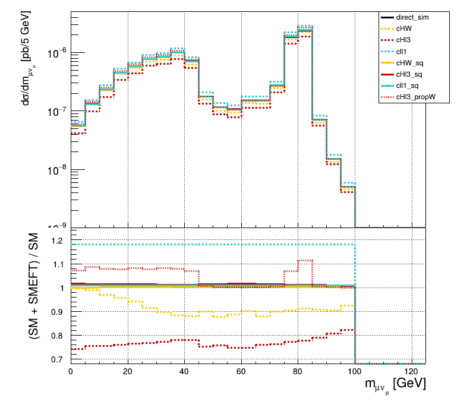

# SMEFTsim 学习实践

[English](README.md) | [简体中文](README.zh-CN.md)

新电脑先按 [首次克隆配置说明](docs/setup/README.zh-CN.md) 下载固定版本依赖并配置隔离运行环境，再阅读主手册。

这是一个个人教学与复现项目：使用已有 SMEFTsim、MadGraph 和 ROOT，
学习 Higgs 四轻子衰变的 SM 生成、事件分析与 SMEFT 重加权。
本项目的贡献是中英文操作说明、环境隔离、输入步骤解释、辅助入口和本地复现示例。

**先读 [handbook.md](handbook.zh-CN.md)。** 主手册只保留学习顺序和实际操作；
背景、参数、目录和发布说明放在对应 README 中。

| 入口 | 阅读目的 |
|---|---|
| [主手册](handbook.zh-CN.md) | 按步骤生成 SM、调用 ROOT、执行重加权 |
| [Linux 与终端入门（可选）](docs/linux-basics/README.zh-CN.md) | Linux 基本命令、提示符与路径 |
| [物理背景](docs/physics/README.zh-CN.md) | Warsaw basis、flavor、scheme、微分宽度 |
| [软件与 Notebook](docs/model/README.zh-CN.md) | 模型、生成器和 Mathematica 的分工 |
| [过程卡](cards/README.zh-CN.md) | 模型导入、restriction、NP 与 NPprop 阶数 |
| [脚本说明](scripts/README.zh-CN.md) | 每个辅助脚本的功能、环境和使用时机 |
| [本地重加权示例](examples/reweighted/README.zh-CN.md) | 2,000 个事件、11 个权重、ROOT 与 PDF |
| [发布与许可证](docs/publishing/README.zh-CN.md) | 上游许可、署名，以及从 WSL 提交到 GitHub |

图来自本项目生成的事件，使用 Ilaria Brivio 的 2023 年教程中的 `plot_histos.py` 绘制。
图中保留该脚本的轴标签；本例是衰变宽度，旧 `pb` 标签的解释见 [图的说明](docs/figures/README.zh-CN.md)。

## 来源与致谢

| 项目或教程 | 作者/维护者 | 本项目如何使用 |
|---|---|---|
| [SMEFTsim 教程索引](https://smeftsim.github.io/tutorials.html) | SMEFTsim 项目 | 选择学习路线 |
| [2023 年 Higgs 衰变教程](https://github.com/IlariaBrivio/SMEFTsim_tutorial_June23) | Ilaria Brivio | 过程、卡、UFO、分析器和绘图方法；固定提交 `92ffde994d7c0d90554ee629cc477ee171c76b84` |
| [SMEFTsim](https://github.com/SMEFTsim/SMEFTsim) | Ilaria Brivio、Yun Jiang、Michael Trott 等贡献者 | 教程模型 v3.0.2；模型与理论说明 |
| [MadGraph5_aMC@NLO](https://github.com/mg5amcnlo/mg5amcnlo) | MadTeam | 生成器 2.9.27；固定提交 `eb76cab72b8d44aac7162ac7221ac08a4384a169` |
| [ROOT / PyROOT](https://root.cern/) | ROOT 团队 | 读取直方图与绘图 |
| [SMEFTsim 3.0 practical guide](https://arxiv.org/abs/2012.11343) | Ilaria Brivio | 背景、参数与模型实现 |
| [The SMEFTsim package, theory and tools](https://arxiv.org/abs/1709.06492) | I. Brivio、Y. Jiang、M. Trott | 原始包的理论和工具说明 |
| [Warsaw basis](https://arxiv.org/abs/1008.4884) | B. Grzadkowski、M. Iskrzyński、M. Misiak、J. Rosiek | 算子基底的参考 |
| [PDG Kinematics](https://pdg.lbl.gov/2025/reviews/rpp2025-rev-kinematics.pdf) | Particle Data Group | 宽度、相空间与运动学定义 |
| [Microsoft WSL](https://learn.microsoft.com/en-us/windows/wsl/install) | Microsoft | 专用 Linux 运行环境 |

模型、生成器和教程的署名见上表。这是独立的学习整理，不代表所列项目或贡献者背书。
用于科学论文时，请按所使用工具的要求引用相关论文。

## 文件与许可边界

- 自己生成的示例放在 `examples/reweighted`；数据来源、参数和校验值在 `metadata.json`。
- 公开 LHE 是分析用导出：保留数值初始化、事件和权重，省略完整软件与卡片模板 header；原始 run 仍保留本地。
- 第三方程序、环境和下载的教程材料留在本地，从上游获取，不随本仓库发布。
- 教程仓库未找到明确许可；其 Python 3 副本继续本地使用，但由 Git 忽略规则排除。
- 参数索引引用 MIT 许可的 SMEFTsim 模型，许可文本保存在 [licenses](licenses/README.zh-CN.md)。

署名不能代替许可。详细边界见 [THIRD_PARTY_NOTICES.md](THIRD_PARTY_NOTICES.zh-CN.md)。
本项目自有文档和辅助脚本尚未选择统一发布许可证；上游许可不自动成为本项目许可。
