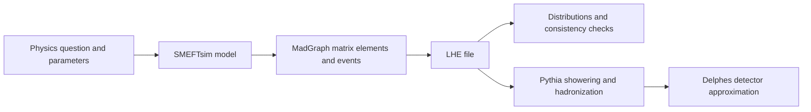
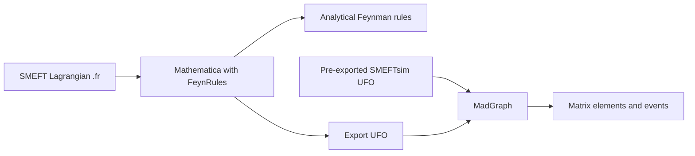

# SMEFTsim and the software workflow

[English](README.md) | [简体中文](README.zh-CN.md)

This guide explains what the model package provides, how MadGraph and ROOT fit into the workflow, and what the Mathematica notebooks are for. Return to the [handbook](../../handbook.md) to continue the exercises.

## 3. What SMEFTsim provides, and its scope

### 3.1 What the package contains

According to the [SMEFTsim website](https://smeftsim.github.io/) and the [practical guide](https://arxiv.org/abs/2012.11343), SMEFTsim provides FeynRules source files and exported UFO models for automated SMEFT calculations.

- Load the FeynRules source in Mathematica to study the Lagrangian and derive Feynman rules.
- A UFO is a model format read by event generators. It contains particles, parameters, vertices, coupling orders, and related model information.
- Use MadGraph to construct matrix elements, export process code, and generate events.
- Choose a flavor assumption and an electroweak input scheme; linear propagator corrections can also be studied separately.

SMEFTsim offers the `general`, `U35`, `MFV`, `top`, and `topU3l` flavor models, each with either `alphaScheme` or `MwScheme`. This exercise uses one fixed combination.

### 3.2 Roles in the software workflow

This tutorial covers LHE generation and distribution checks. The purely leptonic Higgs decay example does not require Pythia or Delphes. SMEFTsim itself does not perform the entire workflow of detector simulation, fitting real data, or training a neural inference model.

### 3.3 State the calculation's scope explicitly

The local tutorial generates events at tree level. The name `aMC@NLO` in MadGraph does not imply that every imported UFO automatically supports a complete SMEFT calculation at NLO.

Some SM loop-induced Higgs interactions in SMEFTsim use approximations such as the heavy-top limit. Check the manual for their range of validity. This tutorial sets `SMHLOOP=0`, excluding those effective vertices.

A successful software run establishes that the configuration can execute. Interpreting its physics still requires checking the model assumptions, EFT truncation, parameter card, integration uncertainty, and reference samples. A simulated distribution is not automatically the same as a real-data distribution.

### 3.4 What the SMEFTsim Mathematica notebooks do

The SMEFTsim model repository's [Mathematica_notebooks directory](https://github.com/SMEFTsim/SMEFTsim/tree/main/Mathematica_notebooks) is separate from the downloaded 2023 MadGraph tutorial. The current tutorial copy contains no `.nb` files. The SMEFTsim repository README describes two uses:

| Notebook | Purpose | Needed for this exercise? |
|---|---|---|
| `SMEFTsim_usage_examples.nb` | Load `.fr` models with FeynRules, choose flavor and scheme, and extract Feynman rules or analytical expressions | No: the supplied UFO already supports event generation for this tutorial |
| `SMEFTsim_SMHloop_FRs.nb` | Store precomputed Feynman rules for SM loop-generated Higgs couplings, for use by another notebook | No: this example sets `SMHLOOP=0` |

The first notebook helps answer questions such as “Which vertices does this operator in the Lagrangian produce?” For example, use FeynRules to inspect the rules involving `cHW` and compare their momentum structures with the SM vertices. This is useful for analytical study, model checks, and changes to the source Lagrangian. To pass a modified model to an event generator, export the corresponding UFO through FeynRules.

The second notebook mainly serves as a resource containing rules that have already been computed. The SMEFTsim repository README recommends calling `NotebookEvaluate["SMEFTsim_SMHloop_FRs.nb"]` as shown in the first notebook, rather than opening the whole file to inspect its many cells. Its presence does not mean that the UFO automatically performs a complete one-loop SMEFT calculation.

The two workflows are:

This tutorial follows “Pre-exported SMEFTsim UFO → MadGraph.” Study the notebook/FeynRules workflow later when you want to trace a vertex back to its source. That workflow requires a separate FeynRules setup; this project has not installed it into the global Windows environment.

See the [SMEFTsim repository README](https://github.com/SMEFTsim/SMEFTsim#installation-and-usage) for the documented purposes of these files.
