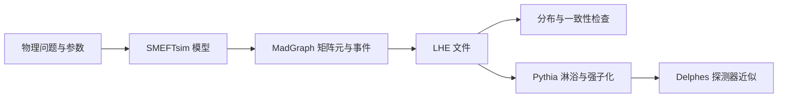
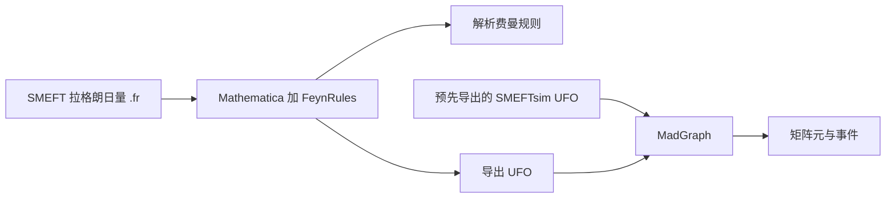

# SMEFTsim 与软件链

[English](README.md) | [简体中文](README.zh-CN.md)

这里解释模型包的功能、MadGraph/ROOT 的职责，以及 Mathematica Notebook 的用途。
返回 [主手册](../../handbook.zh-CN.md) 后即可继续操作。

## 3. SMEFTsim 的功能与边界

### 3.1 它提供什么

根据 [SMEFTsim 项目网站](https://smeftsim.github.io/) 和 [实用手册](https://arxiv.org/abs/2012.11343)，
SMEFTsim 提供 FeynRules 源码和预先导出的 UFO 模型，用于自动化 SMEFT 计算。

- FeynRules 源码可以在 Mathematica 中载入，研究拉格朗日量并导出费曼规则。
- UFO 是生成器读取的模型格式，包含粒子、参数、顶点和耦合阶数等信息。
- 通过 MadGraph 可构造矩阵元、导出过程代码并生成事件。
- 可选择 flavor 假设和电弱输入方案；可单独研究线性传播子修正。

SMEFTsim 的模型选项包括 `general`、`U35`、`MFV`、`top`、`topU3l`，
各自可配 `alphaScheme` 或 `MwScheme`。本练习先固定一种组合。

### 3.2 软件链中的职责

本教程先走到 LHE 和分布检查。Higgs 的纯轻子衰变例子不需要先安装 Pythia 或 Delphes。
SMEFTsim 本身不承担探测器模拟、自动拟合真实数据或训练神经推断器的全部工作。

### 3.3 计算范围要明确

本地教程是树级事件生成。MadGraph 名称中有 `aMC@NLO`，
不代表任何导入的 UFO 都自动提供完整 SMEFT 的 NLO 计算。
SMEFTsim 中部分 SM loop-induced Higgs 相互作用采用重顶极限等近似，使用范围需按手册判断。
教程设置 `SMHLOOP=0`，不使用这类有效顶点。

软件运行成功只证明该配置可执行。物理结果仍需核对模型假设、截断、参数卡、
积分误差和参考样本；模拟分布也不自动等于真实数据分布。

### 3.4 SMEFTsim 的 Mathematica Notebook 用来做什么

SMEFTsim 模型仓库的 [Mathematica_notebooks 目录](https://github.com/SMEFTsim/SMEFTsim/tree/main/Mathematica_notebooks)
与我们下载的 2023 年 MadGraph 教程是不同的材料；当前教程副本没有 `.nb` 文件。
SMEFTsim 仓库 README 列出两种用途：

| Notebook | 作用 | 当前练习是否需要 |
|---|---|---|
| `SMEFTsim_usage_examples.nb` | 配合 FeynRules 载入 `.fr` 模型、选择 flavor/scheme、提取费曼规则或解析表达式 | 已有 UFO 时，生成本教程事件不需要运行它 |
| `SMEFTsim_SMHloop_FRs.nb` | 保存预先导出的 SM loop-generated Higgs 耦合费曼规则，供另一个 Notebook 调用 | 本例使用 `SMHLOOP=0`，当前不用这些规则 |

第一种 Notebook 帮助你回答“拉格朗日量中的这个算子，会产生怎样的顶点？”
例如可用 FeynRules 单独查看 `cHW` 相关的费曼规则，再与 SM 顶点的动量结构比较。
它适合解析学习、检查模型，以及需要修改源拉格朗日量的工作。
若要把修改后的模型交给生成器，还需通过 FeynRules 的导出流程生成相应 UFO。

第二种主要是一份已经算好的规则资源。SMEFTsim 仓库 README 建议按第一个 Notebook 的示例调用
`NotebookEvaluate["SMEFTsim_SMHloop_FRs.nb"]`，而不是直接打开整个文件查看大量单元格。
它不意味着 UFO 会自动做完整的一圈 SMEFT 计算。

可以这样理解两条工作路径：

本教程走的是“预先导出的 SMEFTsim UFO → MadGraph”。以后要追问一个顶点的来源时，
再学习 Notebook/FeynRules 这条路径。Notebook 路径还需要单独配置 FeynRules；
本任务没有把它安装进 Windows 全局环境。
文件用途可核对 [SMEFTsim 仓库 README](https://github.com/SMEFTsim/SMEFTsim#installation-and-usage)。
