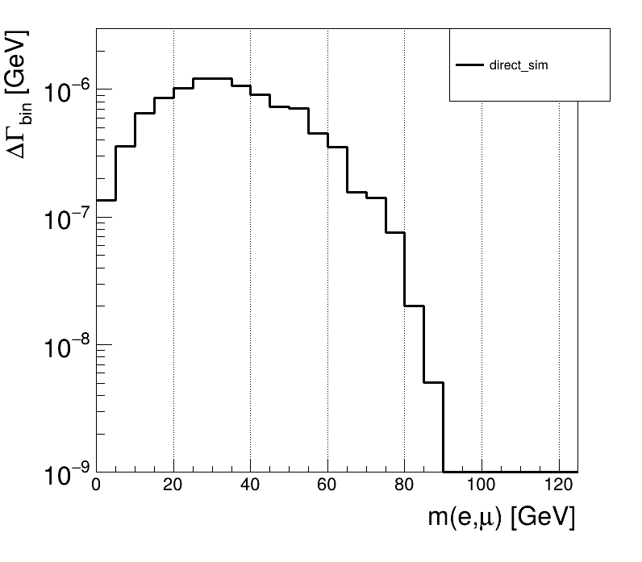

# SMEFTsim Learning and Operations Handbook

[English](handbook.md) | [简体中文](handbook.zh-CN.md)

These practical notes follow [Ilaria Brivio's June 2023 SMEFTsim tutorial](https://github.com/IlariaBrivio/SMEFTsim_tutorial_June23). The learning sequence is:
**understand SMEFT → read the reference plots → generate and plot your own SM sample → compare EFT contributions through reweighting.**

This handbook uses the Linux project's shared `.venv` environment and ROOT.
The authors' original material remains in `tutorial`; local analysis and plotting use Python 3-compatible copies.
The [root README](README.md) explains the directories, scripts, and all sources.
Section 8 calls ROOT's existing plotting interfaces directly; Section 9 calls the authors' plotting script. Neither requires a new analysis program.

Read Section 0 first to learn where to type, when to press Enter, and when to wait.
If you already have an SM sample, obtain your own plots in Sections 8.5–8.6, then complete Sections 9.3–9.4.
Section 9 completes the main tutorial exercise.

The commands use this project's WSL distribution name `SMEFTsim`, Linux user `smeft`, and example paths.
On another computer, prepare the corresponding environment and replace the Windows username, project path, and Linux home directory.
This repository shares teaching documents, configuration, images and selected generated analysis examples; virtual environments, third-party downloads and complete simulation runs stay local.

## 0. First: where to type and when to press Enter

### 0.1 Ordinary terminal commands: finish the whole command, then press Enter once

The `bash` and `powershell` blocks follow the same rule:

1. Copy or type **one complete command**.
2. Press **Enter once** to execute it.
3. Wait for it to finish and for the terminal prompt to return before typing the next command.
4. When a block contains several commands, run them one at a time in order; do not execute the entire block immediately.

**A line wrapping on screen does not start a new command.** A long command may occupy two screen lines,
but you must enter all of it before pressing Enter. Do not press Enter immediately after `.lhe`, or omit `>` or the output path.
Blank lines in ordinary terminal blocks are only for readability; you do not need to type them.

Every executable terminal block below is marked "one command at a time."
For a block containing `cd ...` followed by `python ...`, enter the complete `cd` command and press Enter,
wait for the prompt, then enter the complete `python` command and press Enter.

### 0.2 Use the prompt to identify your current environment

| Prompt shown by the terminal | Current environment | What to enter |
|---|---|---|
| `PS C:\...>` | Windows PowerShell | Commands in `powershell` blocks |
| `smeft@...:~/smeftsim$`, or similar | Linux Bash | Commands in `bash` blocks |
| `>>>` | Interactive Python interpreter | Code marked "interactive Python" |
| `...` | Python is waiting for an unfinished statement or indented block | Continue the statement; finish a loop with one blank line |
| `MG5_aMC>`, `MadEvent>`, or a tool-selection menu | MadGraph/MadEvent | The answer requested by the current menu, or a MadGraph command |

These are **prompts displayed by the terminal**; do not include them when typing a command.
Once you enter Linux, a Windows path such as `C:\...` cannot be used directly.
At Python's `>>>` prompt, do not enter Bash commands such as `cd` or `ls`.

If Linux displays a lone `>` and waits, your input usually contains an unclosed quote or unfinished statement.
Press `Ctrl+C` to cancel the unfinished input, then copy the complete command again.
A `>` **inside a command**, however, redirects output. It is part of the command and must stay.

Typing `python` and pressing Enter switches from Bash to Python's `>>>` prompt.
In Python, type `exit()` and press Enter to return to Bash.
In Bash, type `exit` and press Enter to leave the Ubuntu terminal; this differs from `exit()`.
`deactivate` only leaves the virtual environment, keeping the Linux terminal open.

### 0.3 Distinguish interactive Python from editing a file

- **Ordinary Python statements:** at `>>>`, enter one complete line and press Enter once; `>>>` should return when it finishes.
- **Python loops:** enter each line and press Enter, preserving indentation. After the last line, Python still displays `...`.
  **Type nothing and press Enter once more** to run the loop. Section 8.6 gives line-by-line instructions.
- **Editing files:** code marked "file contents" belongs in the named file, opened in an editor.
  In the editor, Enter only inserts a new line. Press `Ctrl+S` to save your changes; do not execute these contents in the terminal.
- **Names, logs, and illustrations:** `text` blocks, file listings, and diagrams are usually for reading,
  not typing. Examples explicitly identified as MadGraph commands belong inside that tool.

If an error occurs, stop at the current step and check the environment, directory, complete arguments, and error message.
Do not paste later plotting commands into an unfinished loop or menu.

### 0.4 Read the common Linux commands used in this tutorial

| Command | What it does | What you normally see after pressing Enter |
|---|---|---|
| `pwd` | Shows the current directory | One absolute path |
| `cd directory` | Changes the current directory | Usually no output; the directory in the prompt changes |
| `mkdir -p directory` | Creates a directory, or reuses it if it exists | Usually no output on success |
| `source .venv/bin/activate` | Makes this terminal use the project's Python and dependencies | Often `(.venv)` in the prompt; check with `which python` |
| `which python` | Shows which Python interpreter is selected | Here, `/home/smeft/smeftsim/.venv/bin/python` |
| `ls -lh file` | Checks whether a file exists and displays its size | Filename, time, and a readable size |
| `head -n 1 file` | Shows the first line | An LHE file should start with `<LesHouchesEvents ...>` |
| `cat file` | Prints a card or text file | Its contents; the file is unchanged |
| `cp source destination` | Copies a file or directory | Usually returns quietly; an existing destination may be overwritten |
| `gzip -dc compressed_file > new_file` | Decompresses into a new file, keeping the compressed original | Usually no output on success; check with `ls` |
| `python script.py arguments...` | Runs a script with the current interpreter | Script logs, results, or an error |
| `./process/bin/generate_events run_name` | Starts the generator under the current directory | A tool menu, followed by integration and generation logs |
| `zcat file.gz \| sed ...` | Decompresses into a stream, then selects part of it | Here, the weight declarations; keep the pipe character `\|` |

For `gzip`, `-d` means decompress and `-c` sends the contents to standard output.
`>` then writes that output to the named file. It overwrites an existing file with the same name,
so use a separate output directory for each exercise.
The script filename after `python` does not count as a script argument:
`lhe_analyzer.py` needs two arguments, "input LHE + output ROOT";
`plot_histos.py` needs one, "input ROOT."

### 0.5 How to read paths

The main Linux working directory is `/home/smeft/smeftsim`.
Here, `~` means `/home/smeft`, so `~/smeftsim` identifies the same directory.
`outputs/my_pyroot_reference/events.lhe` is a relative path, interpreted from the project root.
`../../work/...` means go up two directory levels before locating the script.
Use `/mnt/c/...` to access the Windows C drive from Linux.

Linux filenames are case-sensitive: `Material` and `material` are different directories.
Copy quotes together with paths that are enclosed in single or double quotes.
If a step first asks you to `cd` into a directory, execute that command and press Enter before copying the script command.

## Contents

0. [First: where to type and when to press Enter](#0-first-where-to-type-and-when-to-press-enter)
1. [Learning goals and prerequisites](#1-learning-goals-and-prerequisites)
2. [SMEFT background](#2-smeft-background)
3. [What SMEFTsim does and its limitations](#3-what-smeftsim-does-and-its-limitations)
4. [Environment isolation and file locations](#4-environment-isolation-and-file-locations)
5. [Start the environment and check dependencies](#5-start-the-environment-and-check-dependencies)
6. [Reproduce the reference plots with the authors' ROOT scripts](#6-reproduce-the-reference-plots-with-the-authors-root-scripts)
7. [Choose the model and understand process commands](#7-choose-the-model-and-understand-process-commands)
8. [Generate your own SM sample](#8-generate-your-own-sm-sample)
9. [Reweighting and ROOT plots](#9-reweighting-and-root-plots)
10. [Save results and share the project](#10-save-results-and-share-the-project)
11. [Learning schedule and completion criteria](#11-learning-schedule-and-completion-criteria)
12. [Versions and references](#12-versions-and-references)

## 1. Learning goals and prerequisites

After completing the project, you should be able to:

1. Explain the model's flavor assumption, input scheme, restriction, and EFT order.
2. Configure cards and generate an SM run with its own name.
3. Convert SM LHE events to ROOT histograms and use ROOT to plot four kinematic distributions.
4. Read the authors' reweight cards, calculate contributions for specified coefficients, and compare them with the SM.

The tutorial uses this fixed combination:

| Component | Configuration used here | Purpose |
|---|---|---|
| Linux | Dedicated WSL2 Ubuntu 22.04 distribution named `SMEFTsim` | Runs the generator and compilers |
| Python | 3.10, in the Linux project's `.venv` | Runs generation, reweighting, and ROOT in one environment |
| MadGraph | 2.9.27 | Exports processes, integrates, generates events, and reweights |
| SMEFTsim UFO | Tutorial v3.0.2, U35 / MwScheme | Defines interactions and input parameters |
| NumPy / setuptools | 1.26.4 / 69.5.1 | Retains the build interfaces needed for this reweighting workflow |
| ROOT | Official Python distribution 0.1a12, corresponding to 6.40.00 | Stores histograms and produces plots |

This combination has passed local execution checks. Exact dependencies are listed in `requirements-linux.txt`
and `requirements-linux.lock.txt`. The pinned versions reproduce this tutorial; they are not a recommendation for the latest research setup.

Terminal instructions start from an **already prepared dedicated Linux environment**.
On a new computer, first prepare WSL2/Ubuntu, a Python virtual environment, compilers, and the third-party material.
Follow the [fresh-clone setup guide](docs/setup/README.md) for the complete preparation sequence.
Section 4 explains the directories; see [tools](tools/README.md) and [scripts](scripts/README.md) for downloads and environment details.

## 2. SMEFT background

The full background is in [docs/physics/README.md](docs/physics/README.md). Refer to it as questions arise.

### 2.1 Why use an effective field theory?

New physics at high energies can appear as additional interactions in low-energy processes.
[Explanation and expansion](docs/physics/README.md#21-why-use-an-effective-field-theory).

### 2.2 Wilson coefficients, energy scales, and units

The tutorial's Wilson coefficients are dimensionless, while the scale is entered in GeV; record both.
[Formula and units](docs/physics/README.md#22-wilson-coefficients-the-scale-and-units).

### 2.3 What is the Warsaw basis?

It is a basis of independent operators after redundancies have been removed. Field strengths themselves contain derivatives.
[Basis, derivatives, and how much theory to learn](docs/physics/README.md#23-what-is-the-warsaw-basis).

### 2.4 Why separate linear and quadratic terms?

The SM term, interference, and dimension-six squared term are distinct contributions to the squared amplitude.
The dimension-six squared term alone is not a complete higher-order EFT prediction.
[Full explanation](docs/physics/README.md#24-why-distinguish-linear-and-quadratic-terms).

### 2.5 Flavor: how new interactions distinguish fermion generations

This tutorial chooses U35. Different flavor assumptions impose different relationships between generations.
[Physical meaning of the five choices](docs/physics/README.md#25-flavor-how-new-interactions-distinguish-fermion-generations).

### 2.6 Scheme: which measurements determine electroweak parameters?

MwScheme uses mW, mZ, and GF as electroweak inputs.
[Input schemes and derived parameters](docs/physics/README.md#26-scheme-which-measurements-determine-the-electroweak-parameters).

### 2.7 Differential width: distributing a decay rate over kinematic regions

Here, the integrated quantity is a partial decay width in GeV. Histogram bin contents differ from a density obtained by dividing by the bin width.
[Formulas, symbols, and histogram interpretation](docs/physics/README.md#27-differential-widths-distributing-a-decay-channels-rate-over-kinematic-regions).

## 3. What SMEFTsim does and its limitations

### 3.1 What it provides

SMEFTsim provides FeynRules/UFO models for generators to calculate with. It does not generate events by itself.

### 3.2 Responsibilities in the software chain

This tutorial follows **UFO → MadGraph → LHE → ROOT → plots**.
See the [software guide](docs/model/README.md) for the roles of the model, generator, and analysis tools.

### 3.3 Define the calculation's scope

This example is a tree-level Higgs decay to four leptons. Successful execution does not by itself establish the calculation's full physical accuracy.
See the [software guide](docs/model/README.md#33-state-the-calculations-scope-explicitly) for the model's scope and approximations.

### 3.4 What is the official Mathematica notebook for?

The notebook is used to derive Feynman rules and develop the model. You do not need to run it first if you already have the UFO.
[Notebook purpose and the two workflows](docs/model/README.md#34-what-the-smeftsim-mathematica-notebooks-do).

## 4. Environment isolation and file locations

### 4.1 Extent of isolation

Generation, reweighting, and ROOT share the Linux project's `.venv`; tools and compilers live inside the dedicated WSL distribution.
The global Windows Python installation is not used in this workflow. See [vm/README.md](vm/README.md) for the isolation details.

### 4.2 Directory map

| Directory contents | Reading entry point |
|---|---|
| Helper scripts | [scripts/README.md](scripts/README.md) |
| Process cards and order selection | [cards/README.md](cards/README.md) |
| Physics, parameters, figures, and publishing guidance | [docs/README.md](docs/README.md) |
| Teaching examples generated in this project | [examples/README.md](examples/README.md) |
| Local working files | [work/README.md](work/README.md) |
| Regenerable outputs | [outputs/README.md](outputs/README.md) |
| The authors' reference results | [reference/README.md](reference/README.md) |
| Third-party programs | [tools/README.md](tools/README.md) |
| Virtual-machine assets | [vm/README.md](vm/README.md) |

`tutorial` retains the authors' original README. Dependencies, third-party source trees, and generator internals retain their own documentation.
This project does not replace it with a README in every internal directory.
The Linux project is at `/home/smeft/smeftsim`;
the Windows collection is at `C:\Users\符文\Desktop\NSBI\smeftsim`. They do not synchronize automatically.

## 5. Start the environment and check dependencies

### 5.1 Enter the project's Linux environment

In Windows PowerShell, go to the project directory on this computer. The example assumes `user directory/Desktop/NSBI/smeftsim`.
If your project is elsewhere, replace the path after `cd`.

**Windows PowerShell | one command at a time:** enter each complete line and press Enter once. The second command enters Linux.

```powershell
cd "$env:USERPROFILE\Desktop\NSBI\smeftsim"
.\scripts\enter-linux.ps1
```

Wait until you see `smeft@...$` before typing the next section's Bash commands.

### 5.2 Activate the shared environment

**Linux Bash | one command at a time:** each line is a complete command. After pressing Enter, wait for the prompt to return.

```bash
cd /home/smeft/smeftsim
source .venv/bin/activate
python --version
which python
python -c "import ROOT; print(ROOT.gROOT.GetVersion())"
gfortran --version
```

Check that:

- `python --version` reports Python 3.10.
- `which python` points to `/home/smeft/smeftsim/.venv/bin/python`.
- ROOT reports `6.40.00`, and the compiler displays its version.

Then continue to Section 6. You can generate, reweight, and plot in the same terminal without switching environments.
To leave the virtual environment, enter `deactivate` and press Enter. To leave Linux, enter `exit` and press Enter.

## 6. Reproduce the reference plots with the authors' ROOT scripts

This section uses PyROOT and Python 3-compatible copies of the authors' scripts inside the project's shared `.venv`.
The sequence is **LHE → `lhe_analyzer.py` → ROOT histograms → `plot_histos.py` → four PDFs**.
First learn the calls with the authors' existing sample, then replace the input with your own reweighted SM sample.
Section 2.7 explains the vertical axis, areas under curves, and normalization.

### 6.1 What are we simulating?

The process is:

$$h\to e^-\bar\nu_e\mu^+\nu_\mu.$$

The Higgs produces four leptons through two intermediate W bosons.
Since $m_h$ is smaller than the sum of two on-shell W masses, both W bosons cannot be on shell.
The four-body final-state kinematics let us compare EFT effects in different regions.

| Plot name | Observable | Meaning |
|---|---|---|
| `mll` | $m_{e\mu}$ | Invariant mass of the charged-lepton pair |
| `mmv` | $m_{\mu\nu_\mu}$ | Invariant mass of the muon and its corresponding neutrino |
| `pTl1` | $\max(p_T^e,p_T^\mu)$ | Transverse momentum of the charged lepton with the larger transverse momentum |
| `pTmu` | $p_T^\mu$ | Muon transverse momentum |

These are generator-level variables. Using the true neutrino momentum does not imply that a detector can directly measure the same quantity.

This process is a Higgs **decay**: the integrated result is a partial width $\Gamma$ in GeV.
The authors' older plotting script uses generic cross-section labels in `pb`; this handbook retains those labels and explains the actual units in Section 6.6.
For a scattering process, quantities such as cross sections must follow the generator's conventions; do not copy the units of this decay example.

### 6.2 Reading the upper and lower panels

The upper panel shows each kinematic bin's contribution to the width. Dividing by the bin width gives a differential width.
The lower panel shows:

$$R(X)=\frac{(\text{SM}+\text{one selected contribution})(X)}{\text{SM}(X)}.$$

The black line is the SM. Each colored line adds only one selected contribution to show its effect.
For example, `SM + cHl3 quadratic` does not also include the linear term.
That curve is therefore not a complete EFT prediction at `cHl3=1`.
The authors' plots show central values without statistical uncertainty bands. Bins with zero SM content or sparse statistics are unsuitable for judging ratios.

The [official tutorial](https://smeftsim.github.io/tutorials.html) suggests observing that:

- The `cHbox` and `cll1` linear terms give flat ratios in this example, indicating that they mainly change the rate.
- The `cHW` and `cHl3` linear terms give non-flat ratios, indicating that they also change the shape.
- Propagator corrections deserve attention where a W is close to being on shell.
- The squared terms for the chosen coefficients are small here; this is not a general result for all energy regions or coefficients.

The authors' SM sample has an integrated width of approximately $1.00868\times10^{-5}\ \mathrm{GeV}$.
Your smaller sample need not match its final digits; compare results together with their integration uncertainties.

### 6.3 Where are the authors' ROOT files?

In the Windows project, the reference ROOT files are under `reference/Results/Root_files`,
and the LHE files under `reference/Results/Hvlvl_*/Events/run_01`.
See [reference/README.md](reference/README.md) for their structure and source.
Section 6.5 works from these already downloaded files.

### 6.4 Activate PyROOT while preserving the authors' scripts

The shared `.venv` activated in Section 5 already contains ROOT. There is no need to switch environments during normal use.
The actual scripts called in Linux are `work/Material/pyroot_python3/lhe_analyzer.py` and `plot_histos.py`.

The [working-copy README](work/Material/pyroot_python3/README.md) describes the originals, the arguments required by both scripts,
and how to convert them on a new computer.
Tutorial code without a confirmed license is used only locally; the public repository includes conversion instructions rather than these copies.

**Linux Bash, project root | one command at a time:**

```bash
source .venv/bin/activate
which python
python -c "import ROOT; print(ROOT.gROOT.GetVersion())"
```

Python should come from the project's `.venv`, and ROOT should report 6.40.00.

### 6.5 Complete LHE → ROOT → PDF with the authors' sample

**Starting point: Linux Bash, with `.venv` activated as in Section 6.4.**
This section turns the original events into histograms, then plots them with the authors' script.
At each small step, run only its command: **enter the whole command → press Enter once → wait → check the result**.
If a command fails, stop rather than continuing to the next step.

#### A. Decompress and analyze: six input steps

If your file already passes checks A4 and A5, continue at A6 without decompressing it again.

**A1. Return to the project root.** Enter this line and press Enter once:

**Linux Bash | one command at a time:** each line is one complete command. Press Enter once, wait for it to finish, then enter the next line.

```bash
cd /home/smeft/smeftsim
```

`cd` only changes directories and normally prints nothing on success. When the prompt returns, proceed to A2.

**A2. Prepare the output directory.** Enter this line and press Enter once:

**Linux Bash | one command at a time:** each line is one complete command. Press Enter once, wait for it to finish, then enter the next line.

```bash
mkdir -p outputs/my_pyroot_reference
```

`mkdir -p` creates the directory or reuses it if it already exists; it normally prints nothing on success.
This directory holds the decompressed file, ROOT file, and PDFs for this exercise without changing the reference package.

**A3. Decompress into a file.** Copy the **entire command** below, then press Enter once at its end:

**Linux Bash | one command at a time:** each line is one complete command. Press Enter once, wait for it to finish, then enter the next line.

```bash
gzip -dc '/mnt/c/Users/符文/Desktop/NSBI/smeftsim/reference/Results/Hvlvl_SM/Events/run_01/unweighted_events.lhe.gz' > outputs/my_pyroot_reference/events.lhe
```

Screen wrapping is fine: this is still one command. Do not press Enter after the closing quote or before `>`.

| Command part | Meaning |
|---|---|
| `gzip -dc` | Decompresses while keeping the original `.gz`, sending the contents to standard output |
| Quoted `...unweighted_events.lhe.gz` | The authors' compressed input event file |
| `>` | Writes the output to the following file; it is part of the command, not a prompt |
| `outputs/my_pyroot_reference/events.lhe` | The new decompressed file |

Decompression may produce no visible output for a short time. **Wait for the Bash prompt to return**, then proceed to A4.
Silence alone does not prove success; do not immediately enter the analysis command.

**A4. Check that the file was created.** Enter this line and press Enter once:

**Linux Bash | one command at a time:** each line is one complete command. Press Enter once, wait for it to finish, then enter the next line.

```bash
ls -lh outputs/my_pyroot_reference/events.lhe
```

Expect a nonempty file of approximately **33 MiB**.
If you see `No such file or directory`, or its size is zero, stop here.
Check A3's error message, full path, and `>` before continuing to A5 or A6.

**A5. Check the first line.** Enter this line and press Enter once:

**Linux Bash | one command at a time:** each line is one complete command. Press Enter once, wait for it to finish, then enter the next line.

```bash
head -n 1 outputs/my_pyroot_reference/events.lhe
```

Expect something like `<LesHouchesEvents version="3.0">`.
This reads only the first line and does not change any events.

**A6. Generate ROOT histograms with the authors' analyzer.** Copy the **complete line** below and press Enter once at its end:

**Linux Bash | one command at a time:** each line is one complete command. Press Enter once, wait for it to finish, then enter the next line.

```bash
python work/Material/pyroot_python3/lhe_analyzer.py outputs/my_pyroot_reference/events.lhe outputs/my_pyroot_reference/Hvlvl_SM.root
```

| Command part | Meaning |
|---|---|
| `python` | The interpreter in the shared `.venv` |
| `work/Material/pyroot_python3/lhe_analyzer.py` | The compatible working copy of the authors' analysis script |
| `outputs/my_pyroot_reference/events.lhe` | First script argument: input LHE file |
| `outputs/my_pyroot_reference/Hvlvl_SM.root` | Second script argument: output ROOT file, created by the script |

**Do not press Enter after `events.lhe`.** The output ROOT path must be in the same command.
If the script reports `two command-line arguments required`, the second argument is missing.
Complete the command and run it again; successful decompression does not need to be repeated.

Wait while it runs without entering another command. On success, expect `processed 20000 events`,
the integral of each weight, and `file ... produced`, followed by the Bash prompt.
The analyzer reads four-momenta, fills bins for four observables, and normalizes by the actual event count.
Do not divide by 20,000 again yourself.

#### B. Plotting: two input steps

**B1. Enter the output directory.** Enter this line and press Enter once:

**Linux Bash | one command at a time:** each line is one complete command. Press Enter once, wait for it to finish, then enter the next line.

```bash
cd /home/smeft/smeftsim/outputs/my_pyroot_reference
```

The current directory determines where the PDFs are saved. Wait for the prompt before B2.

**B2. Call the authors' plotting script.** Enter the full line and press Enter once:

**Linux Bash | one command at a time:** each line is one complete command. Press Enter once, wait for it to finish, then enter the next line.

```bash
python ../../work/Material/pyroot_python3/plot_histos.py Hvlvl_SM.root
```

`../../` goes up two directory levels to find the script; `Hvlvl_SM.root` is the input in the current directory.
The plotting script needs one ROOT argument, whereas the analyzer in A6 needs two arguments.
Wait until plotting finishes and the Bash prompt returns, then check:

**Linux Bash | one command at a time:** each line is one complete command. Press Enter once, wait for it to finish, then enter the next line.

```bash
ls -lh plot_mll.pdf plot_mmv.pdf plot_pTl1.pdf plot_pTmu.pdf
```

Press Enter only once for this checking command too. It should list four nonempty PDFs.

**B3. Open the PDFs in Windows.** Open a separate **Windows PowerShell** terminal;
do not enter this command at Python's `>>>`. Enter the full line and press Enter once:

**Windows PowerShell | one command at a time:** each line is one complete command. Press Enter once, wait for it to finish, then enter the next line.

```powershell
explorer.exe '\\wsl.localhost\SMEFTsim\home\smeft\smeftsim\outputs\my_pyroot_reference'
```

File Explorer opens the output directory. Double-click a PDF to read it.

**Optional shortcut, rather than the next step:**
To redraw the authors' existing ROOT file, skip the decompression and analysis in A.
Create and enter the output directory above, then enter this full line and press Enter once:

**Linux Bash | one command at a time:** each line is one complete command. Press Enter once, wait for it to finish, then enter the next line.

```bash
python ../../work/Material/pyroot_python3/plot_histos.py '/mnt/c/Users/符文/Desktop/NSBI/smeftsim/reference/Results/Root_files/Hvlvl_SM_run_01.root'
```

Choose either this command or B2; they use different inputs, so do not run both in succession.
Plotting again overwrites PDFs with the same names. The authors' `make_rootfiles.sh` calls the analyzer in batches
and assumes `run_01`. Here, calling the scripts individually makes each input, output, and run name clear.

### 6.6 Adjust the authors' existing plot settings if needed

First complete Section 6.5 with the authors' default settings.
In `plot_histos.py`, `weights_to_plot` selects curves and `histo_dc` controls display ranges.
These are optional plot settings, not changes required for Python 3 compatibility.

To show only the six corrections below, change `weights_to_plot` in the **Linux working copy** to these file contents.
**Where to do this: a text editor, not the terminal.** In the editor, Enter only inserts a new line.
Preserve commas, quotes, and brackets, press `Ctrl+S` to save, then return to Bash and run the plotting command:

```python
weights_to_plot = [
    default_wgt,
    "cHbox",
    "cll1",
    "cHW",
    "cHl3",
    "cHl3_sq",
    "cHl3_propW",
]
```

The authors' default ratio range for `pTl1` is `.95, 1.05`.
If curves extend beyond it, change those two limits to `.68, 1.25`, then rerun the same plotting command.
Keep the other dictionaries and algorithms unchanged.
The plotting script cannot calculate a contribution missing from the ROOT file. If a curve is absent, check the reweight labels first.

The [figure README](docs/figures/README.md) explains the original plots' width units, bin widths, and curve meanings.

## 7. Choose the model and understand process commands

### 7.1 Why this model is used

The model is `SMEFTsim_U35_MwScheme_UFO-massless_Hvlvl`:
the U35 flavor assumption, MwScheme electroweak inputs, and the tutorial's custom restriction.
[Model explanation](cards/README.md#71-why-this-example-uses-this-model).

### 7.2 A restriction differs from a parameter card

A restriction simplifies the model at import time; the parameter card sets the adjustable inputs for a run.
Vertices removed during import are not restored by subsequently editing the parameter card.
[Full distinction](cards/README.md#72-a-restriction-is-different-from-a-parameter-card).

### 7.3 Order options: select amplitudes, then select their products

| Target | Authors' process options, all with `SMHLOOP=0` |
|---|---|
| SM baseline | `NP=0 NPprop=0` |
| Ordinary linear interference | `NP=1 NP^2==1 NPprop=0` |
| Ordinary dimension-six squared contribution | `NP==1 NPprop=0` |
| Propagator interference | `NP=0 NPprop=2 NPprop^2==2` |

`NP=1` is an upper bound at amplitude level; `NP==1` selects an exact order.
`NP^2` counts the sum of orders on the two sides of an amplitude product. The `NPprop` counting of dummy vertices is not the number of EFT insertions.
The expanded formulas, two detailed tables, and dummy-vertex implementation are in
[cards/README.md](cards/README.md#73-coupling-order-options-select-amplitudes-then-terms-in-their-square).

### 7.4 Which UFO parameters exist, and which should you set?

For this exercise, record the model, coefficients, `LambdaSMEFT`, widths, seed, and cuts.
Internal parameters follow the model's formulas and are not all independent inputs.
See [parameter categories and the basis for their values](docs/parameters/README.md)
and the [complete parameter index](docs/parameters/model_parameter_reference.md).

## 8. Generate your own SM sample

**Prerequisite: prepare the environment and pass the checks in Section 5. Run the following commands in Linux Bash.**
Start with 2,000 events: enough to practice the workflow. Increase the statistics later for detailed distribution comparisons.

### 8.1 Export the process

**Linux Bash | one command at a time:** each line is one complete command. Press Enter once, wait for it to finish, then enter the next line.

```bash
cd /home/smeft/smeftsim
source .venv/bin/activate
bash scripts/run_generator.sh check_model
```

Check `outputs/check_model.log` for successful model import and all four process definitions.
If `work/Material/Hvlvl_SM` has not been created, run:

**Linux Bash | one command at a time:** each line is one complete command. Press Enter once, wait for it to finish, then enter the next line.

```bash
bash scripts/run_generator.sh generate_sm
```

If the process directory already exists, go straight to configuring cards and creating a new run.
The helper script refuses to overwrite an existing process directory. One exported process can contain several differently named runs.

### 8.2 Configure the cards

**Linux Bash | one command at a time:** each line is one complete command. Press Enter once, wait for it to finish, then enter the next line.

```bash
cd work/Material
cp param_card_Hvlvl.dat Hvlvl_SM/Cards/param_card.dat
cp run_card_Hvlvl.dat Hvlvl_SM/Cards/run_card.dat
```

| Card | Main contents | Settings for this exercise |
|---|---|---|
| `param_card.dat` | Masses, couplings, Wilson coefficients, scale, and widths | All EFT coefficients zero; `LambdaSMEFT=1000`; retain the authors' widths |
| `run_card.dat` | Event count, seed, integration, and cuts | `nevents=2000`, `iseed=23456`; retain the other settings |
| `reweight_card.dat` | Weight definitions for new parameter points and processes | Leave reweighting disabled during the SM exercise |

Open the cards in a text editor you know. If Ubuntu has no desktop editor, open the file directory from Windows PowerShell:

**Windows PowerShell | one command at a time:** each line is one complete command. Press Enter once, wait for it to finish, then enter the next line.

```powershell
explorer.exe '\\wsl.localhost\SMEFTsim\home\smeft\smeftsim\work\Material\Hvlvl_SM\Cards'
```

Do this in an **editor**, without entering card contents in the terminal. Enter inserts a new line; press `Ctrl+S` when finished.
Check that you are editing the Linux working copy. To change the event count, edit `nevents` in `run_card.dat`.
Naming a run `...2000` does not make the generator produce 2,000 events automatically.
Cards commonly use `value = parameter_name` or `index value # parameter comment`; preserve the original file's format.

### 8.3 Generate a run with its own name

**Linux Bash, current directory `work/Material`:**

**Linux Bash | one command at a time:** each line is one complete command. Press Enter once, wait for it to finish, then enter the next line.

```bash
./Hvlvl_SM/bin/generate_events training_sm_2000
```

After pressing Enter, you enter MadGraph's tool menu; **you are no longer at an ordinary Bash prompt**.
Follow this sequence, without pasting later analysis commands into the menu:

1. Check the tool statuses. If necessary, enter `shower=OFF` and press Enter once.
   Do the same separately for `detector=OFF`, `analysis=OFF`, and `reweight=OFF`.
   Do not repeat settings that are already OFF or unavailable because the tool is not installed.
2. Once the statuses are correct, enter `done` and press Enter once to continue.
3. If a parameter/run-card editing menu appears and you have already saved the cards in Section 8.2, enter that menu's `0` or `done`
   and press Enter once to accept the current cards. Follow the displayed options if the menu does not accept one of these answers.
4. Integration, compilation, and generation logs follow. **Wait. Do not repeatedly press Enter or type other commands.**
5. Continue to Section 8.4 only after the program finishes and the Bash prompt returns.

`training_sm_2000` is the new run name. If you have used it before, inspect the existing result first.
To generate again, choose a new name such as `training_sm_v2`, and replace it consistently in later paths.
The output should be under `Hvlvl_SM/Events/training_sm_2000`, including the LHE file and banner.
`smoke_sm_2000` names an installation-check run; the different name here preserves it.

### 8.4 Check what you generated

Check the following:

1. The process is the intended Higgs decay, and the model and restriction have not changed to another version.
2. The banner records the requested parameters, scale, seed, and event count.
3. The LHE file contains complete events with the correct final state, and a positive integrated width with a reported Monte Carlo integration uncertainty.
4. Compare the SM width and four distributions with the authors' results. Consider whether any differences can be explained by statistics or version settings.

Matching the seed, versions, and cards helps reproducibility, but compiler differences and parallel execution can affect event-by-event agreement.
For research records, preserve the full configuration and statistical results; matching the final digit is not the only criterion.

### 8.5 Create a ROOT file for the SM distributions

This section produces four histograms **containing only the SM baseline**.
Section 9 uses the original compressed events to calculate additional contributions; the two sections use different analysis inputs.

The authors' analyzer reads declarations of additional weights from the LHE header.
To plot only the SM, remove these declarations and additional-weight blocks from a separate **analysis copy**, retaining the original SM events.
Particle four-momenta, the original SM weights, and the event count remain unchanged. Keep the original `.lhe.gz`.

**Starting point: Linux Bash with `.venv` activated. Enter each whole command, press Enter once, and wait for it to finish.**

#### A. Prepare the directory and decompressed copy

**Linux Bash | one command at a time:**

```bash
cd /home/smeft/smeftsim
mkdir -p outputs/my_sm_visual
gzip -dc work/Material/Hvlvl_SM/Events/training_sm_2000/unweighted_events.lhe.gz > outputs/my_sm_visual/events_full.lhe
```

The final command is one complete line: enter the compressed input path, `>`, and output path before pressing Enter.
For another run, replace only `training_sm_2000`.
`events_full.lhe` is a decompressed copy; the original compressed file is unaffected.

#### B. Prepare the input used only for SM analysis

**Linux Bash | enter the whole line, then press Enter once:**

```bash
sed -e '/<initrwgt>/,/<\/initrwgt>/d' -e '/<rwgt>/,/<\/rwgt>/d' outputs/my_sm_visual/events_full.lhe > outputs/my_sm_visual/events_sm.lhe
```

| Command part | Meaning |
|---|---|
| `sed` | Processes text according to rules, without editing the source file |
| First `-e ...` | Removes the additional-weight declaration block `<initrwgt>... </initrwgt>` |
| Second `-e ...` | Removes each event's additional-weight block `<rwgt>... </rwgt>` |
| `events_full.lhe` | The complete decompressed input copy |
| `> .../events_sm.lhe` | Saves the result as a separate SM analysis input |

This step **does not fill missing EFT weights with zeros**. It selects the original SM weights for analysis
without calculating additional contributions. Use `events_sm.lhe` only in this section; Section 9 reweights the original `.lhe.gz`.

**Linux Bash | check each command separately:**

```bash
ls -lh outputs/my_sm_visual/events_sm.lhe
head -n 1 outputs/my_sm_visual/events_sm.lhe
```

Expect a nonempty file whose first line starts with `<LesHouchesEvents ...>`.

#### C. Call the authors' analyzer

**Linux Bash | enter the whole line, press Enter once, then wait for it to finish:**

```bash
python work/Material/pyroot_python3/lhe_analyzer.py outputs/my_sm_visual/events_sm.lhe outputs/my_sm_visual/Hvlvl_SM.root
```

`events_sm.lhe` is the first argument and `Hvlvl_SM.root` the second.
Enter both together with the script path; do not press Enter early after the LHE path.

With no additional weights, the analyzer may print `no new weights found`, which is expected here.
At the end, expect `processed 2000 events` and `file ... produced`.
If you requested another event count, use the actual number. Wait for the Bash prompt before Section 8.6.

The ROOT file should contain four histograms:
`mll_direct_sim`, `mmv_direct_sim`, `pTl1_direct_sim`, and `pTmu_direct_sim`.
The authors' analyzer has already normalized by the event count; do not divide again.

### 8.6 Use ROOT to plot your own SM distributions

Here you call ROOT's existing `TFile`, `TCanvas`, `Draw`, and `SaveAs` interfaces.
The authors' analyzer has filled the histograms, so there is no need to rewrite the event analysis.

#### A. Enter Python from Bash

**Linux Bash | one command at a time:** run `cd` first, then `python`.

```bash
cd /home/smeft/smeftsim/outputs/my_sm_visual
python
```

After the second command, Python displays `>>>`. From this point, enter only Python code.

#### B. Open the ROOT file and prepare a canvas

**Interactive Python | enter each complete line and press Enter once. Wait for `>>>` before the next line.**
The long `labels = ...` line is also one statement; enter the whole line before pressing Enter.

```python
import ROOT
ROOT.gROOT.SetBatch(True)
file = ROOT.TFile.Open("Hvlvl_SM.root")
canvas = ROOT.TCanvas("sm", "SM distributions", 800, 600)
canvas.SetLogy()
observables = ["mll", "mmv", "pTl1", "pTmu"]
labels = {"mll": "m_{e#mu} [GeV]", "mmv": "m_{#mu#nu_{#mu}} [GeV]", "pTl1": "p_{T}^{leading lepton} [GeV]", "pTmu": "p_{T}^{#mu} [GeV]"}
```

`SetBatch(True)` enables saving plots without requiring an Ubuntu graphical desktop.
`TFile.Open` reads the histograms, `TCanvas` creates a canvas, and `SetLogy` gives a logarithmic vertical axis.
`labels` uses ROOT's axis-title syntax; for example, `#mu` represents the Greek letter μ.

#### C. Plot and save the four existing histograms

**Interactive Python loop | press Enter after each line, preserve indentation, then finish with one additional blank Enter.**

1. Enter `for obs in observables:` and press Enter; Python displays `...`.
2. Preserve **4 spaces** at the beginning of each of the next seven lines, pressing Enter after each.
3. After the final `canvas.SaveAs(...)` line, Python still displays `...`.
4. **Type nothing and press Enter once more** to execute the entire loop.
5. Wait for four sets of file-saving messages and for `>>>` to return.

```python
for obs in observables:
    hist = file.Get(obs + "_direct_sim")
    hist.SetTitle("SM: " + obs)
    hist.GetXaxis().SetTitle(labels[obs])
    hist.GetYaxis().SetTitle("Partial width per bin [GeV]")
    hist.Draw("hist")
    canvas.SaveAs("SM_" + obs + ".pdf")
    canvas.SaveAs("SM_" + obs + ".png")

```

`Get` retrieves a histogram; `Draw("hist")` plots its bin contents.
`SaveAs` saves a PDF or PNG according to the extension. Title changes occur only in memory and are not written back to the ROOT file.
The vertical axis is the **partial-width contribution per bin, in GeV**, rather than a differential density divided by bin width.

#### D. Close the file and return to Bash

**Interactive Python | press Enter once after each line:**

```python
file.Close()
exit()
```

After `exit()`, the Bash `$` prompt should return. Check the results:

**Linux Bash | enter the whole line, then press Enter once:**

```bash
ls -lh SM_*.pdf SM_*.png
```

Expect four PDFs and four PNGs: one of each for `mll`, `mmv`, `pTl1`, and `pTmu`.

Open a separate **Windows PowerShell** terminal, enter the whole line, and press Enter:

```powershell
explorer.exe '\\wsl.localhost\SMEFTsim\home\smeft\smeftsim\outputs\my_sm_visual'
```

Double-click a PNG or PDF. Start by examining the peak positions, distribution tails, and overall scale.
The SM partial width in this example is approximately `1e-5 GeV`; different random seeds produce statistical fluctuations.

Below is this project's 2,000-event SM example. Your result need not match it bin by bin:



Other examples: [muon–neutrino invariant mass](docs/figures/sm_mmv.png),
[leading-lepton transverse momentum](docs/figures/sm_pTl1.png),
and [muon transverse momentum](docs/figures/sm_pTmu.png).

**Section complete:** you have converted your own SM LHE sample into ROOT, PDF, and PNG files.
Continue to Section 9 to calculate EFT contributions on the same original SM events.

## 9. Reweighting and ROOT plots

This section uses the original SM LHE from Section 8 to calculate the additional contributions defined by the authors' cards on the same events.
The SM analysis copy in Section 8.5 is only for plotting the SM alone; it is not the reweighting input here.
Sections 9.1–9.2 explain the principles and card contents; the actual operations start in Section 9.3.
Section 9.4 produces `outputs/my_pyroot_reweighted/Hvlvl_SM.root` and four comparison plots.

### 9.1 What does reweighting do?

For the same event kinematics $x$, ordinary parameter reweighting compares matrix elements at two parameter settings:

$$r(x)=\frac{|\mathcal M(x;\theta_{\rm target})|^2}{|\mathcal M(x;\theta_{\rm base})|^2}.$$

Under the appropriate sampling and normalization conventions, event weights can estimate a target distribution
without generating a large new sample for every parameter point.
The base sample must cover the target's relevant kinematic regions; statistical efficiency deteriorates when a few events carry extremely large weights.

This tutorial also uses `change process` to calculate **linear, squared, or propagator contributions** separately.
The weight named `cHl3` is therefore the selected linear interference contribution, not a probability ratio for a complete target EFT point.
Interpret each label together with the process and order selection in the reweight card.

### 9.2 Read a reweight card

The `cHl3` block in the authors' `reweight_card_int.dat` has the following meaning.
**These are card-file contents, for reading or editing in a text editor. Do not execute them line by line in Bash.**
MadGraph reads the `done` in the card; it is not a menu answer you need to type now:

```text
change process h > e- ve~ mu+ vm SMHLOOP=0 NPprop=0 NP=1 NP^2==1
launch --rwgt_name="cHl3"
set cHbox 0
set cHW 0
set cHl3 1
set cHq3 0
set cll1 0
done
```

The first line selects the interference process; `launch` names the output weight; the following lines set this point's coefficients.
The LHE `<rwgt>` block stores the weights. The original SM weight and additional weights have different meanings and must be distinguished in analysis.
Here, `cHl3` represents the selected linear interference contribution. Other cards select squared or propagator corrections.

#### From a matrix-element ratio to the weights used in plotting

For the same SM event $x_i$, the generator compares the target contribution with the SM matrix element, then multiplies by the base event weight.
For example, the conceptual expression for the linear contribution is

$$
w_{L,i}=w_{S,i}\,
\frac{2\mathrm{Re}(\mathcal M_0^*\mathcal M_6)(x_i)}{|\mathcal M_0(x_i)|^2}.
$$

$w_{S,i}$ is the SM weight, while $w_{L,i}$ is the linear contribution represented by this event; it can be negative.
The LHE weights saved in this example already include generator normalization. Do not multiply them by the SM weight again after reading them.
Squared and propagator contributions have their own target matrix-element expressions.
Event four-momenta and the total event count stay unchanged; only these additional weights change. A new set of events is not needed for each contribution.

For a linear combination, first form $w_S+w_L+w_P$ for each event; add $w_Q$ if also including the squared contribution.
Then sum in each bin and divide by $N$ and the bin width to obtain a density.
Weights on the same event are correlated, so combination uncertainties should be calculated from the summed weights event by event.

### 9.3 Use the authors' reweight cards in MadGraph yourself

The aim is to use the three supplied cards to calculate linear, squared, and propagator contributions for ROOT plotting.
The linear card calculates four single-coefficient linear contributions; the squared card calculates four squared contributions;
the propagator card calculates three width/propagator contributions.
**There is no need to regenerate events for each coefficient or to use the mixed-term card to draw the six reference correction curves.**

| Authors' card | Main weight labels |
|---|---|
| `reweight_card_int.dat` | `cHbox`, `cHW`, `cHl3`, `cll1` |
| `reweight_card_squares.dat` | `cHbox_sq`, `cHW_sq`, `cHl3_sq`, `cll1_sq` |
| `reweight_card_propW.dat` | `cHl3_propW`, `cHq3_propW`, `cll1_propW` |

Other labels in the cards are also calculated, but need not be plotted yet.
Each `launch` is a separate parameter point. For example, the `cHbox` launch has `cHbox=1` with the other coefficients zero;
it does not set all four Wilson coefficients to 1 together. `LambdaSMEFT` retains the base sample's value of 1,000 GeV.
The reweight card's `change process` changes the target contribution; the base events still come from the SM.

#### A. Enter Linux and create your own working copy

**Windows PowerShell:**

**Windows PowerShell | one command at a time:** each line is one complete command. Press Enter once, wait for it to finish, then enter the next line.

```powershell
cd 'C:\Users\符文\Desktop\NSBI\smeftsim'
.\scripts\enter-linux.ps1
```

After entering **Linux Bash**, activate the shared `.venv`, or keep using it if it is already active:

**Linux Bash | one command at a time:** each line is one complete command. Press Enter once, wait for it to finish, then enter the next line.

```bash
cd /home/smeft/smeftsim
source .venv/bin/activate
which python
cd work/Material
ls Hvlvl_SM/Events/training_sm_2000
```

`which python` should point to this project's `.venv/bin/python`.
The card and compiler dependencies require this environment; do not invoke Windows Python.

Use a separate process copy named `Hvlvl_SM_manual` to practice while keeping the original SM process.
**This directory should not exist the first time you do this.** If you have already completed this section, reuse it and skip the copy and old-cache renaming steps.
Check first:

**Linux Bash | one command at a time:** each line is one complete command. Press Enter once, wait for it to finish, then enter the next line.

```bash
ls -d Hvlvl_SM_manual
```

If the directory does not exist, run:

**Linux Bash | one command at a time:** each line is one complete command. Press Enter once, wait for it to finish, then enter the next line.

```bash
cp -a Hvlvl_SM Hvlvl_SM_manual
```

On this computer, the original SM directory already contains reweighting compilation caches `rw_me` and `rw_me_2`.
In the **newly copied process**, rename them to keep them while allowing this exercise to build fresh caches:

**Linux Bash | one command at a time:** each line is one complete command. Press Enter once, wait for it to finish, then enter the next line.

```bash
mv Hvlvl_SM_manual/rw_me Hvlvl_SM_manual/cache_before_manual_rw_me
mv Hvlvl_SM_manual/rw_me_2 Hvlvl_SM_manual/cache_before_manual_rw_me_2
```

Both directories have been verified to exist in the local setup. If you start from an SM process that has never been reweighted,
skip any cache that does not exist. Do not repeat the renaming or change the original `Hvlvl_SM`.
If the original sample already has a `cHl3` label, the authors' card replaces that label in this copy.
Interpret MadGraph's `tag ... already defines, will replace it` message accordingly.

#### B. Linear card: read, copy, then run

**Linux Bash | one command at a time:** each line is one complete command. Press Enter once, wait for it to finish, then enter the next line.

```bash
cat reweight_card_int.dat
cp reweight_card_int.dat Hvlvl_SM_manual/Cards/reweight_card.dat
./Hvlvl_SM_manual/bin/madevent reweight training_sm_2000
```

`cat` prints the card contents: read them before continuing. `cp` places the card where the generator expects it.
The third command, `madevent reweight ...`, enters MadGraph; wait for its question first.
There is **no `-f`**, so the interactive steps remain.
If it asks whether to edit `reweight_card.dat`, check the displayed file, enter `0` or the menu's `done`,
and press Enter once to accept the current card. Enter each menu answer separately and press Enter.
Once compilation/event-processing logs appear, wait without typing further `done` commands until Bash returns.
Prompt wording may vary between versions; follow the current menu.
Compilation and event processing take time. Expect results for four parameter points, then wait for Bash before the next step.

Check the new labels in the LHE header:

**Linux Bash | one command at a time:** each line is one complete command. Press Enter once, wait for it to finish, then enter the next line.

```bash
zcat Hvlvl_SM_manual/Events/training_sm_2000/unweighted_events.lhe.gz | sed -n '/<initrwgt>/,/<\/initrwgt>/p'
```

Checkpoint: `cHbox`, `cHW`, `cHl3`, and `cll1` appear.
These labels denote separate interference contributions, which can be negative; they are not full rates with the SM already added.

#### C. Squared card: change the target process and parameter points

**Linux Bash | one command at a time:** each line is one complete command. Press Enter once, wait for it to finish, then enter the next line.

```bash
cat reweight_card_squares.dat
cp reweight_card_squares.dat Hvlvl_SM_manual/Cards/reweight_card.dat
./Hvlvl_SM_manual/bin/madevent reweight training_sm_2000
```

Accept the current card as before. When it finishes, repeat B's `zcat ... | sed ...` check.
Expect new labels `cHbox_sq`, `cHW_sq`, `cHl3_sq`, and `cll1_sq`.
The authors' card explicitly includes `set cHWB 0` at some points. This restriction already fixes it to zero.
If your version says this parameter is not a free input, check its value and subsequent results; do not make it nonzero.
The previous linear labels should remain in the file.

#### D. Propagator card: calculate corrections with a separate order label

**Linux Bash | one command at a time:** each line is one complete command. Press Enter once, wait for it to finish, then enter the next line.

```bash
cat reweight_card_propW.dat
cp reweight_card_propW.dat Hvlvl_SM_manual/Cards/reweight_card.dat
./Hvlvl_SM_manual/bin/madevent reweight training_sm_2000
```

Accept the current card. After it finishes, inspect the weight header again.
Expect new labels `cHl3_propW`, `cHq3_propW`, and `cll1_propW`, with the earlier labels retained.
Here, `NP=0 NPprop=2 NPprop^2==2` selects propagator interference.
It does not calculate the ordinary `cHl3` interference a second time; Section 7.3 explains the counting.

If the command returns to the terminal without the corresponding labels, inspect the displayed error and the process directory's `ME5_debug`.
Do not continue straight to plotting after a failure. Confirming success also requires checking the actual per-event weights in the next section,
not just the header labels or the process exit code.

#### E. Continue to ROOT analysis

After all three reweighting calls, the file remains in the Linux process directory.
Continue with Section 9.4, calling the authors' analyzer and plotting script in the same `.venv`.
You do not need to copy the LHE file to Windows first.

### 9.4 Plot your own reweighted SM sample with the authors' ROOT script

After Section 9.3, the file should contain the linear, squared, and propagator labels from the authors' cards.
**Linux Bash, still using the activated shared `.venv`:**

**Linux Bash | one command at a time:** each line is one complete command. Press Enter once, wait for it to finish, then enter the next line.

```bash
cd /home/smeft/smeftsim
mkdir -p outputs/my_pyroot_reweighted

gzip -dc work/Material/Hvlvl_SM_manual/Events/training_sm_2000/unweighted_events.lhe.gz > outputs/my_pyroot_reweighted/events.lhe

python work/Material/pyroot_python3/lhe_analyzer.py  outputs/my_pyroot_reweighted/events.lhe  outputs/my_pyroot_reweighted/Hvlvl_SM.root
```

**Check successful analysis before plotting:** expect `processed ... events`, the integrated values of the weights, and `file ... produced`,
followed by the Bash prompt. The current `training_sm_2000` contains 2,000 events, so expect `processed 2000 events`.
For future runs, use their actual event count. If an error occurs, first check Section 9.3's input and weights.

**Linux Bash | one command at a time:** enter the whole line, press Enter once, and wait for the result.

```bash
ls -lh outputs/my_pyroot_reweighted/Hvlvl_SM.root
```

Expect a nonempty ROOT file. `my_pyroot_reweighted` is the directory and `Hvlvl_SM.root` the file.
It comes from the reweighted SM copy and contains the SM baseline plus additional contributions. The ROOT file from Section 8.5 contains only the SM baseline.

**Linux Bash | one command at a time:** first change directories and press Enter; then enter the complete plotting command, press Enter, and wait for it to finish.

```bash
cd outputs/my_pyroot_reweighted
python ../../work/Material/pyroot_python3/plot_histos.py Hvlvl_SM.root
```

The first Python command analyzes the LHE file; the second plots the histograms. Both call compatible copies of the authors' scripts.
Expect four `plot_*.pdf` files. Open them from Windows PowerShell:

**Windows PowerShell | one command at a time:** each line is one complete command. Press Enter once, wait for it to finish, then enter the next line.

```powershell
explorer.exe '\\wsl.localhost\SMEFTsim\home\smeft\smeftsim\outputs\my_pyroot_reweighted'
```

When comparing with Section 6.5's reference PDFs, keep the same `weights_to_plot` and display ranges.
Curves should have the same meanings, overall scales, and main shapes; randomly generated events need not agree bin by bin.
To select the six corrections listed in Section 6.6, adjust the working-copy settings as described there.

The additional LHE weights already include generator normalization; the authors' analyzer then divides by the event count according to its convention.
Do not multiply by the SM weight again or divide by the event count twice.
The plots retain the authors' central-value presentation without complete statistical uncertainty bands.

Check that the LHE weight declarations match the actual weights in every event. The analysis log should report the full event count and the integral of each contribution.

Below is this project's reweighted example, based on 2,000 SM events and the authors' plotting-script settings.
Axis labels are retained as supplied; Section 6.6 explains the width units and bin convention.


Other examples: [mll](docs/figures/rw_mll.png), [leading-lepton transverse momentum](docs/figures/rw_pTl1.png),
and [muon transverse momentum](docs/figures/rw_pTmu.png).

**Section complete:** you have the multi-curve plots corresponding to the authors' cards. This completes the main tutorial workflow.

## 10. Save results and share the project

### 10.1 Quick reference for routine operations

See [scripts/README.md](scripts/README.md) for the entry points and each script's role.
To redraw the saved output, use [examples/reweighted](examples/reweighted/README.md).

### 10.2 Save an exercise

Keep the original compressed LHE file, cards, banner, versions, parameters, seed, actual event count, and important plots.
See [examples/reweighted/metadata.json](examples/reweighted/metadata.json) for the saved example's records.

### 10.3 Which files belong on GitHub?

The root [README](README.md) lists all sources and acknowledgments.
The [publishing guide](docs/publishing/README.md) explains license boundaries, copying files from WSL, and Git commit steps.
Upload ordinary files rather than the entire WSL virtual disk.

### 10.4 Organize local outputs

See [outputs/README.md](outputs/README.md) for the current outputs; keep shared examples separate from run outputs.
You may remove decompressed files that can be recreated, but keep `.venv`, original runs, and the virtual disk.

## 11. Learning schedule and completion criteria

The main work can be split into four sessions; computational waiting time is additional:

| Session | Active learning time | Task | What you should be able to explain |
|---|---:|---|---|
| 1 | 30–40 minutes | Sections 2–3: physics and the software chain | How SMEFTsim describes new interactions |
| 2 | 30–40 minutes | Section 6: call the authors' scripts and read the reference plots | Weight labels, rate, shape, and bins |
| 3 | 30–45 minutes | Sections 7–8: generate and plot your own SM sample | The roles of the model, the two cards, LHE, and ROOT |
| 4 | 30–45 minutes | Section 9: reweight and plot comparisons | How different contributions come from the same base events |

Afterward, try explaining in your own words:

1. Why U35 and MwScheme were chosen, and how a restriction differs from a parameter card.
2. What the SM, interference, dimension-six squared, and propagator contributions mean.
3. How the coefficients and scale in the cards correspond to the Lagrangian.
4. Why one event can have several weights, and why interference weights can be negative.
5. Which operators mainly change the overall rate, and which also change the shape.

Completing Section 9 finishes this tutorial exercise.
Research use requires further checks of sampling coverage, statistical uncertainties, and agreement between reweighting and direct generation.
Confirm the model version, EFT truncation, and width conventions with your supervisor before using it for research.

## 12. Versions and references

This tutorial pins Python 3.10, MadGraph 2.9.27, SMEFTsim v3.0.2, and ROOT 6.40.00.
Exact Python dependencies are in `requirements-linux.txt` and `requirements-linux.lock.txt`.
See [metadata.json](examples/reweighted/metadata.json) for the actual versions used for this example.

The full tutorial list, authors, and papers are in the [root README](README.md#sources-and-acknowledgments).
See [THIRD_PARTY_NOTICES.md](THIRD_PARTY_NOTICES.md) for third-party licensing and publication scope.
